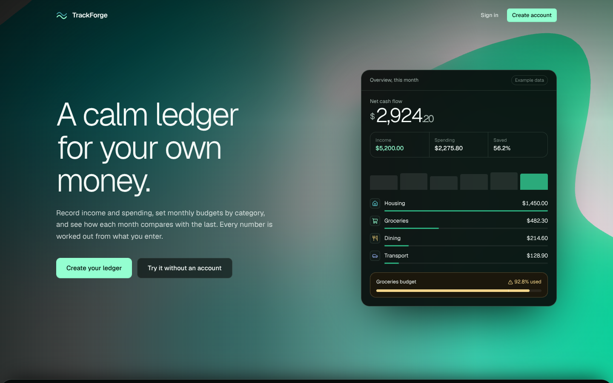
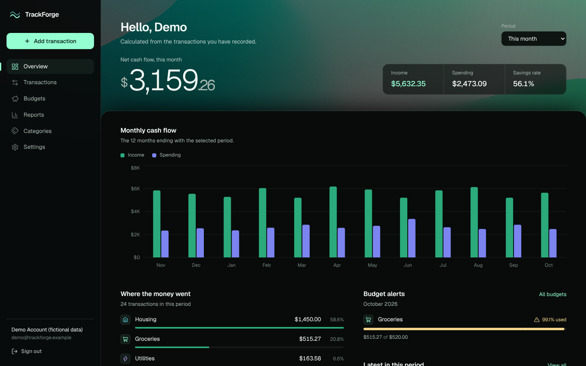
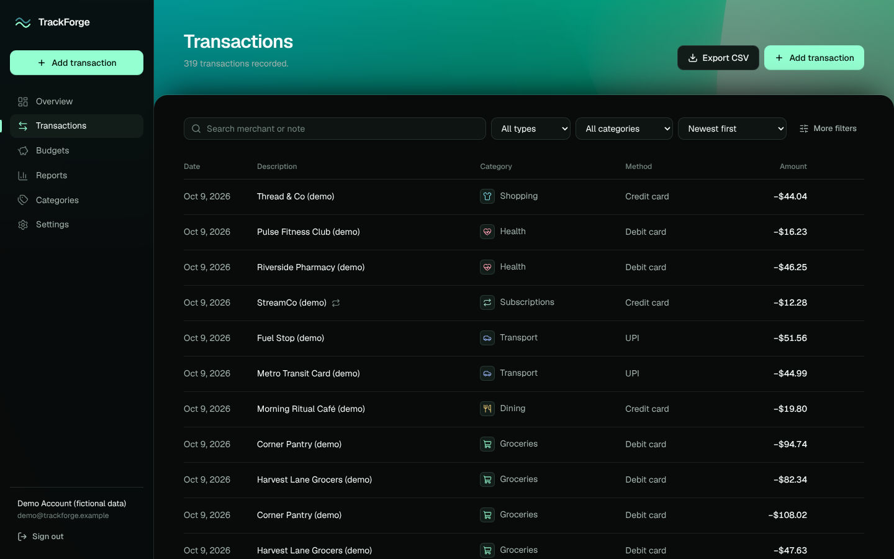
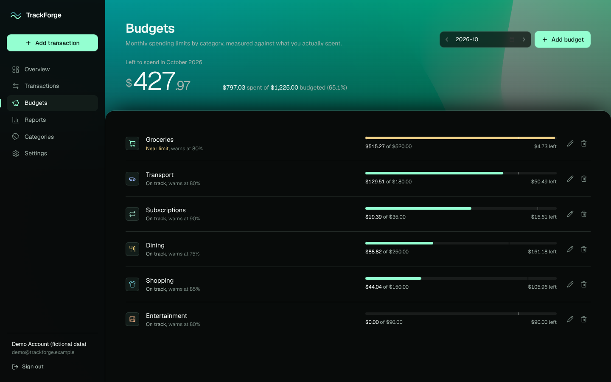
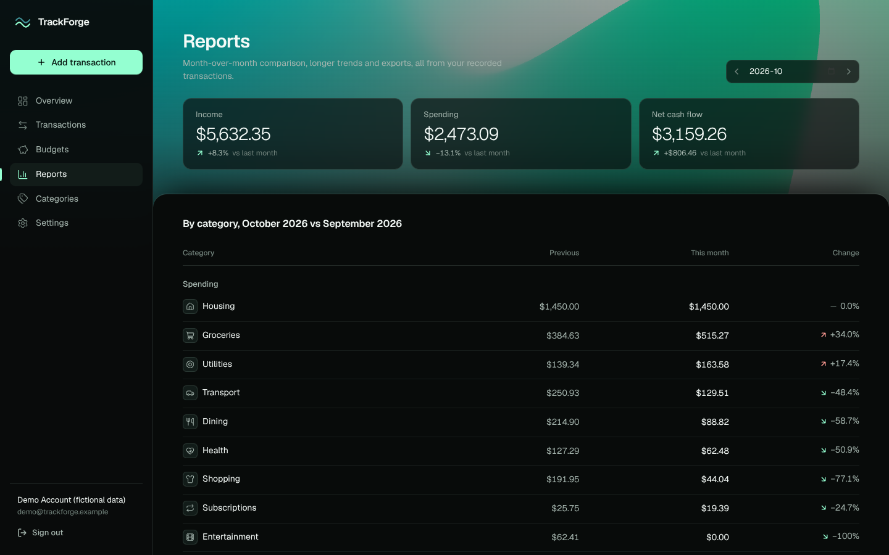

# TrackForge

A personal finance and expense ledger built on the MERN stack with TypeScript end to end. Record income and spending, organise categories, set monthly budgets with warning thresholds, compare months, and export CSV. Every figure is calculated on the server from the transactions you record. There are no AI features, no bank connections and no payments.





| Transactions | Budgets | Reports |
| --- | --- | --- |
|  |  |  |

## Stack

| Layer | Choice |
| --- | --- |
| Web | React 19, Vite 8, TypeScript (strict), Tailwind CSS 4, React Router 8, TanStack Query 5, React Hook Form + Zod 4, Recharts 3, Lucide, Motion |
| Background | `@shadergradient/react` 2.4 (three.js / React Three Fiber 9), lazy-loaded, with static CSS fallback |
| API | Node 22, Express 5, TypeScript, Mongoose 9, express-session + connect-mongo, Argon2id, Helmet, express-rate-limit, Pino |
| Shared | `packages/shared`: Zod schemas, money/date utilities and pure financial calculations used by both sides |
| Tests | Vitest, Supertest, Testing Library, mongodb-memory-server |

## Repository layout

```
trackforge/
  apps/api/          Express API (src/modules/*, middleware, models, services, test)
  apps/web/          React app (src/features/*, components, lib)
  packages/shared/   Schemas, types, money + finance logic (+ unit tests)
  docs/              API, database, shader, deployment notes, screenshots
  .github/workflows/ CI with a real MongoDB service container
```

## Quick start

Requirements: Node.js 20.19+ (22 LTS recommended), npm 10+, and MongoDB 7+ (local, Docker, or Atlas).

```bash
npm install
cp .env.example .env          # then set MONGODB_URI and a real SESSION_SECRET
npm run seed                  # optional: fictional demo account
npm run dev                   # API on :4000, web on :5173 (proxied, same origin)
```

Open http://localhost:5173. With the seed loaded you can sign in as `demo@trackforge.example` / `demo-password-2026` (set `SEED_DEMO_PASSWORD` to choose your own). All demo data is fictional and labelled “(demo)”.

Generate a session secret:

```bash
node -e "console.log(require('crypto').randomBytes(48).toString('base64url'))"
```

Windows: the same commands work in PowerShell and the VS Code terminal. Copy the env file with `Copy-Item .env.example .env`.

### Local MongoDB with Docker

```bash
docker run -d --name trackforge-mongo -p 27017:27017 mongo:8.0
```

### MongoDB Atlas

1. Create a cluster and a database user with the built-in `readWrite` role on the `trackforge` database only.
2. Network Access: add your deployment’s egress IPs (avoid `0.0.0.0/0` in production).
3. Use the `mongodb+srv://…/trackforge?retryWrites=true&w=majority` string as `MONGODB_URI`.
4. Keep `SESSION_STORE_AUTOREMOVE=native` so expired sessions are removed by a TTL index.

## Scripts (run from the repository root)

| Command | What it does |
| --- | --- |
| `npm run dev` | Builds the shared package, then runs API (tsx watch) and web (Vite) together |
| `npm run build` | Shared → API (`apps/api/dist`) → web (`apps/web/dist`) |
| `npm start` | Runs the compiled API (`apps/api/dist/server.js`) |
| `npm run typecheck` | Strict TypeScript across all three packages |
| `npm run lint` | ESLint (typescript-eslint, react-hooks) |
| `npm test` | Shared unit tests, API integration tests, web unit tests |
| `npm run seed` | Idempotent fictional demo account |
| `npm run audit:prod` | `npm audit` for production dependencies |
| `npm run build:preview -w @trackforge/web` | Static click-through preview with example data and an in-browser API stand-in (`apps/web/dist-preview`); not the product build |
| `node scripts/e2e-smoke.mjs` | Optional browser journey (needs `playwright`; see the script header) |

### Tests and MongoDB

API integration tests start a throwaway `mongod` through mongodb-memory-server (downloaded on first run). To use an existing server instead, set `TEST_MONGODB_URI`, for example `TEST_MONGODB_URI=mongodb://127.0.0.1:27017/ npm test`. Each test file creates and drops its own database. If that server cannot create TTL indexes, also set `TEST_SESSION_AUTOREMOVE=interval`.

## Features

- **Accounts**: register, sign in, sign out, profile, currency/locale/time zone/date style, password change (revokes other sessions), sign out other sessions, account deletion.
- **Overview**: net cash flow, income, spending and savings rate for a chosen period; 12-month income vs spending chart; spending by category; budget alerts; latest transactions.
- **Transactions**: create, edit, delete with undo; search merchant/note; filter by type, category, payment method, date range and amount; sort; paginate; filters live in the URL.
- **Categories**: separate income and expense categories with icons and colours; archive to retire without losing history; delete only when unused.
- **Budgets**: per-category monthly limits, warning threshold (50–100%), on track / near limit / over states, copy last month’s budgets.
- **Reports**: month-over-month comparison overall and per category; 6/12/24-month trend with totals, monthly average and a data table; CSV export.
- **Landing page**: hero with a live overview preview built from the app’s own components, a browser-only sandbox that runs the real money and budget rules, and component vignettes for each feature. Example data is labelled.
- **Quality**: loading skeletons, empty and error states with retry, confirmations, toasts, keyboard-operable dialogs, visible focus, reduced-motion support, responsive layouts from 360 px up.

See [docs/API.md](docs/API.md), [docs/DATABASE.md](docs/DATABASE.md), [docs/SHADER.md](docs/SHADER.md), [docs/DEPLOYMENT.md](docs/DEPLOYMENT.md), [ARCHITECTURE.md](ARCHITECTURE.md) and [SECURITY.md](SECURITY.md).

## What TrackForge is not

It does not connect to banks, hold or move money, verify balances, or give financial advice. Totals are only as accurate as the entries you make.
